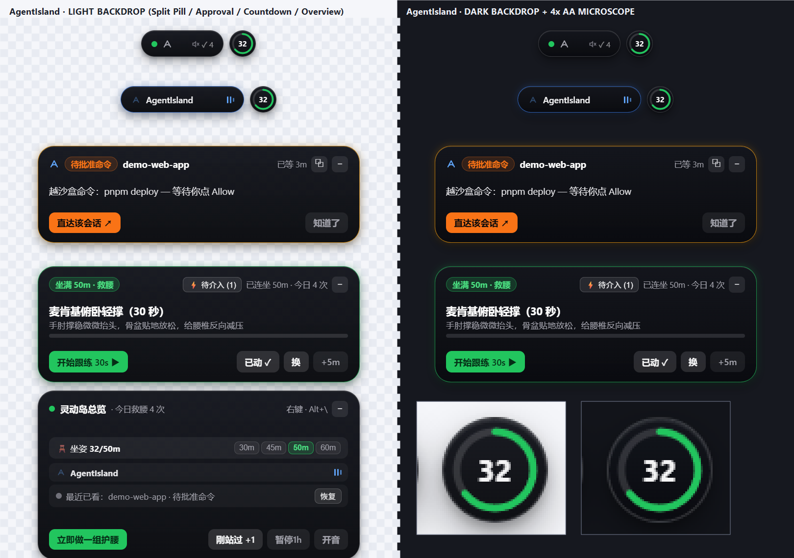
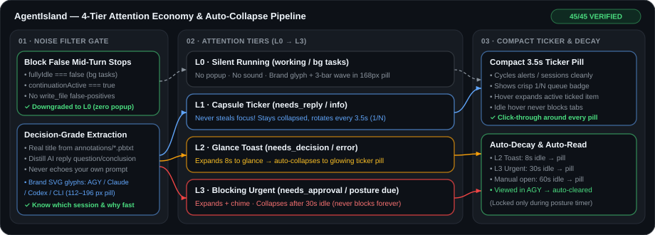
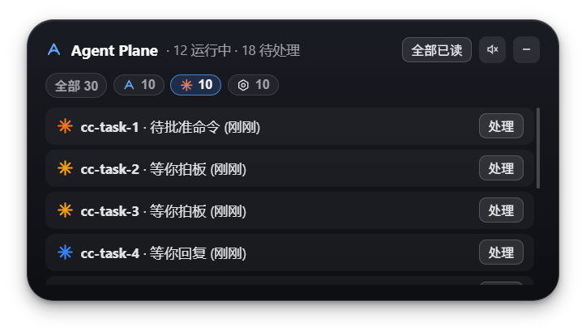

<div align="center">

<h1>AgentIsland</h1>

<p><strong>An 80 KB Native Windows 11 Dynamic Island for AI Coding Agents &amp; Posture Coach</strong></p>

<p><a href="README.md">English</a> · <a href="README.zh-CN.md">简体中文</a></p>

<p>
  <a href="https://github.com/Cooper-X-Oak/AgentIsland"></a>
  <a href="https://github.com/Cooper-X-Oak/AgentIsland/releases"></a>
  <a href="#highlights"></a>
  <a href="#architecture--verification"></a>
  <a href="LICENSE"></a>
</p>

<p>
  
</p>

</div>

---

## Why AgentIsland?

If you run multiple AI coding agents (**Antigravity, Claude Code, Codex CLI, Cursor**) for 12–16 hours a day on Windows, two things quietly wreck your flow and health:

1. **Silent Agent Stalls**: You switch to your browser or another repo while an agent works — only to come back 15 minutes later and find it stuck waiting on an approval dialog or a question card.
2. **Lower-Back Destruction**: Deep flow means sitting for 3 hours straight without standing up once.

**AgentIsland** sits quietly at the top-center of your Windows 11 screen as a strictly decoupled Apple-style **Split Pill**:
* **Left Pill — Pure Agent Plane**: Minimal brand SVG glyphs (`78–232 px`), 4-tier notification attention flow, real conversation titles & decision-grade AI summaries, Fleet Mode brand aggregation (`30+` concurrent agents), and one-click jump back to the exact session. Right-click for pure Agent controls (Clear All, Mute, `Auto / 中 / EN` language).
* **Right Ring — Dedicated Posture & Timer Space**: Tracks real keyboard/mouse seated time via Win32 `GetLastInputInfo` (auto-resets if you lock your PC or step away ≥ 5 min). Hover, click, or right-click the ring for interval chips (`30/45/50/60m`), guided countdown (`30s–120s` with true pause/resume), pause 1h, and daily streak — zero clutter in your Agent Plane.

---

## Highlights

* **Zero Electron, Zero Jagged Edges, Zero Ghost Box**: Built in pure C# with `WS_EX_NOREDIRECTIONBITMAP` + **DirectComposition (`dcomp.dll`)** + system built-in **WebView2 CompositionController**.
  * 80 KB native host binary (~288 KB total portable zip).
  * Sub-pixel anti-aliased rounded corners & soft CSS shadows (`edgeMaxA = 0` on all 4 edges).
  * True cross-process mouse click-through (`WS_EX_LAYERED | WS_EX_TRANSPARENT` dynamically toggled every 30ms — never blocks browser tabs behind the transparent canvas or the 8px gap between split pills).
  * Fixed invisible canvas — **0 px window jump / flicker** during spring morph animations.
  * Automatically yields Z-order to Snipping Tool / screen capture overlays.
* **Attention-First UX & Ultra-Compact Brand Glyphs**:
  * **Minimal Brand SVG Glyphs** (`112–196 px` compact pill): Crisp vector symbols for Antigravity, Claude Code, Codex, and CLI + 3-bar live wave instead of bloated status text.
  * **Decision-Grade Summaries**: Shows the **real conversation title** (from Antigravity `annotations/*.pbtxt`) and distills what the AI actually asked or concluded — never echoes your own prompt back at you.
  * **4-Tier Notification Escalation & Auto-Collapse**: Filters false mid-turn stops (`fullyIdle: false`), keeps L1 replies quietly rotating in the capsule ticker (`1/N` every 3.5s), auto-collapses L2 toasts in 8s and L3 approvals in 30s, and auto-clears alerts once you switch into that session.
  * **Decoupled Split Pill UX & Bilingual (`Auto / 中 / EN`)**: Auto-detects Windows UI language with instant toggle in the right-click menu; hover (`320ms`) expands each side into its own dedicated panel; clicking anywhere outside collapses immediately; `Alt + \` toggles, `Alt + Shift + \` jumps directly to the latest waiting session.
* **Open, Zero-Port Event Bus**: Drop atomic JSON into `%LOCALAPPDATA%\AgentIsland\inbox\` or call `bin\island-push.exe` from any AI terminal, build script, or CI hook.
* **Built-in 45-Point Self-Verification Suite**: Run `.\verify.ps1 -Rebuild` to verify Hook contracts, decision summaries, false-stop filtering, 30-agent burst ingestion, UX state-machine regressions, DirectComposition HRESULTs, real `WindowFromPoint` click-through, per-pixel edge alpha, and generate a 4× anti-aliasing microscope sheet automatically.

---

## Attention Economy & Notification Flow

Not every AI event deserves to interrupt your flow. AgentIsland filters background mid-turn pauses and routes events across **4 attention tiers (`L0`–`L3`)** so your top bar stays calm:



---

## Built for 30+ Concurrent Agents (Fleet Mode)

Running **10 Antigravity + 10 Claude Code + 10 Codex** agents at once? AgentIsland automatically switches to **Fleet Mode** — aggregating counts by brand glyph in the compact pill and unlocking instant brand filter chips + smooth scrolling inside the Agent Plane:

<div align="center">
  
</div>

* **Verified 30-Agent Burst Stress Test**: `30/30` concurrent events ingested in **143 ms** with **0 drops** (`64 KB` `FileSystemWatcher` buffer + `80 ms` burst coalescing + `2.5s` audio cooldown + file `mtime` zero-read caching + `80`-session cap).

---

## Quick Start (30 Seconds)

### Option A: Portable Release (Recommended, No Build Needed)
1. Download `AgentIsland-v0.1.0-win-x64.zip` from [Releases](https://github.com/Cooper-X-Oak/AgentIsland/releases) and extract it.
2. Double-click `bin\AgentIsland.exe` (or run `.\install-autostart.ps1` to add Start Menu & Windows Startup shortcuts).

### Option B: Build from Source (Zero SDK Install!)
Requires Windows 11 (or Windows 10 with Edge WebView2 Runtime). Uses Windows built-in .NET 4.x `csc.exe` and automatically downloads the official WebView2 NuGet DLLs on first run:

```powershell
git clone https://github.com/Cooper-X-Oak/AgentIsland.git
cd AgentIsland
.\build.ps1
.\start.ps1
```

Test both alerts immediately:
```powershell
.\test-push.ps1 -Mode both
```

---

## Connect Your AI Terminals

| AI Terminal | Status | Setup |
| :--- | :---: | :--- |
| **Google Antigravity** (Hooks + `transcript.jsonl` Approval Radar + `Ctrl+K` Exact Session Jump) | Live Verified | `.\adapters\antigravity\install.ps1` |
| **Claude Code** (`UserPromptSubmit` / `PermissionRequest` / `Notification` / `Stop` Hooks) | Contract Verified | `.\adapters\claude-code\install.ps1` |
| **Codex CLI** (`~/.codex/hooks.json` + legacy `notify` + `island-push.exe`) | Contract Verified | `.\adapters\codex-cli\install.ps1` |
| **Cursor / Windsurf / Cline / OpenCode** | Roadmap | PRs welcome! See [`CONTRIBUTING.md`](CONTRIBUTING.md) |

### Universal CLI Push Example
```powershell
.\bin\island-push.exe --source "Codex" --project "api-server" --title "Tests Passed" --body "All 42 unit tests green" --kind info
```

---

## Customize Break Actions & UI

* **Add your own break actions**: Edit [`config/actions.json`](config/actions.json) (change title, countdown seconds, tips, or add neck/eye exercises).
* **Tweak styling or animations**: Edit [`ui/index.html`](ui/index.html) directly.
* Right-click the tray icon → **Reload UI & Actions** — instant hot reload, zero recompilation.

---

## Architecture & Verification

```text
AI Terminals (Antigravity / Claude Code / Codex / CLI)
   └── island-hook.exe / island-push.exe  ──► %LOCALAPPDATA%\AgentIsland\inbox\*.json
                                                      │ (FileSystemWatcher)
Win32 GetLastInputInfo + Lock Detection ──────────────┼──► AgentIsland.exe (80 KB C# Host)
                                                      │     ├── Approval Radar (transcript tail)
                                                      │     ├── WS_EX_NOREDIRECTIONBITMAP + dcomp.dll
                                                      │     ├── Dynamic WS_EX_TRANSPARENT Click-Through
                                                      │     └── CoreWebView2CompositionController ──► ui/index.html
```

Run the automated full-stack verification suite anytime:
```powershell
.\verify.ps1 -Rebuild
```

---

## Roadmap

* [x] DirectComposition anti-aliased Split Pill + real cross-process click-through
* [x] Antigravity hooks + sandbox approval radar + `Ctrl+K` exact conversation jump
* [x] Claude Code hooks adapter + universal `island-push.exe` CLI
* [x] Externalized `config/actions.json` + guided countdown timer + daily streak
* [ ] Multi-monitor selector (choose primary / active cursor monitor)
* [ ] Native adapters for Cursor, Windsurf, Cline, and OpenCode
* [x] Auto-detect Windows system language + instant English / Chinese toggle (`Auto / 中 / EN`)

## License

[MIT](LICENSE)
