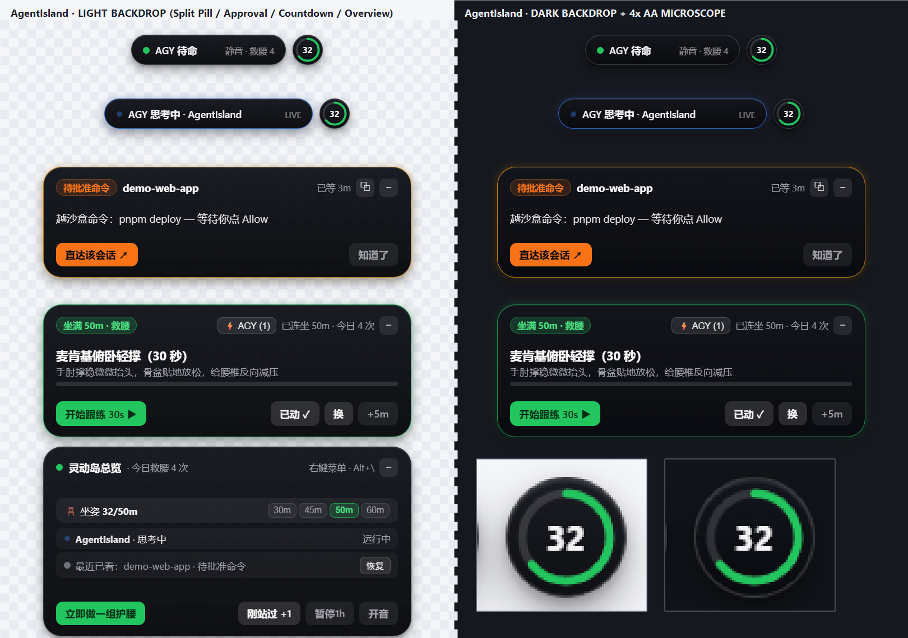

<div align="center">

# AgentIsland

**面向 AI 编程时代的 Windows 11 原生灵动岛（68 KB 零 Electron · 多终端雷达 · 护腰跟练）**

[English](README.md) · [简体中文](README.zh-CN.md)

[](https://github.com/Cooper-X-Oak/AgentIsland)
[](https://github.com/Cooper-X-Oak/AgentIsland/releases)
[](#核心工程亮点)
[](LICENSE)

<br />



</div>

---

## 为什么做 AgentIsland？

在 Windows 上每天高强度开着多个 AI 编程 Agent（**Antigravity、Claude Code、Codex CLI、Cursor**）干活 12–16 小时，有两个最折磨人的痛点：

1. **Agent 悄悄卡住干等**：切去浏览器或另一个项目干活，15 分钟后切回来才发现 Agent 早就停在「权限审批」或「等你拍板」弹窗上白等了。
2. **老腰快坐废了**：一进心流连续 3 小时焊在椅子上，根本记不起站起来深蹲或拉伸。

**AgentIsland** 以苹果式 **Split Pill（双岛并行）** 形态常驻在 Windows 11 屏幕正顶部：
* **左侧主药丸（AI 终端雷达）**：实时显示 Agent 思考状态，毫秒级弹出「待批准命令 / 等你拍板 / 等你回复 / 报错卡住」，标注已等待时长、保留最近 5 条已看历史，支持一键直达 Antigravity 对应会话。
* **右侧独立小圆环（护腰节拍器）**：通过 Win32 `GetLastInputInfo` + 锁屏检测累计真实坐姿时长（离席 ≥ 5 分钟或锁屏自动清零），满周期展开护腰行动卡，内置 **30s–120s 跟练倒计时进度条** 与今日救腰打卡统计。

---

## 核心工程亮点

* **零 Electron、零锯齿、零系统外阴影、零透明墙**：
  * 纯 C# 原生宿主仅 **68 KB**（完整免编译便携 zip 仅 **268 KB**），基于 **`WS_EX_NOREDIRECTIONBITMAP` + DirectComposition (`dcomp.dll`) + 系统内置 WebView2 CompositionController**；
  * 真正亚像素抗锯齿圆角与柔和投影（整圈外框实测 `Alpha = 0`）；
  * **真跨进程鼠标穿透**：通过 `WS_EX_LAYERED | WS_EX_TRANSPARENT` + 30ms 命中切换，胶囊周围空白区与双岛 8px 缝隙 100% 物理穿透，绝不挡下层浏览器标签；
  * **固定隐形画布**：展开/收起全程 Win32 窗口 0 像素位移，彻底杜绝闪烁与横跳；
  * 自动避让 Snipping Tool / 截图录屏工具顶栏。
* **极低摩擦交互**：
  * **Hover 260ms** 轻展开总览、移出 380ms 自动缩回；点击或强提醒锁定展开；
  * **右键药丸/圆环**直接弹内联快捷菜单（刚站过 / 切 30·45·50·60m / 静音 / 暂停 1h）；
  * **全局热键**：`Alt + \` 随时展收，`Alt + Shift + \` 一键直达最新待介入的 Antigravity 会话。
* **开放零端口通知总线**：任何终端、脚本、CI 只要调用 `bin\island-push.exe` 或向 `%LOCALAPPDATA%\AgentIsland\inbox\` 写入 JSON 即可秒级上岛。
* **自带 22 项全视自检套件**：一行 `.\verify.ps1 -Rebuild` 自动验 Hook 契约、DirectComposition、真实垫底窗 `WindowFromPoint` 穿透、5 态外缘 `Alpha = 0`、0 闪身并生成 4× 抗锯齿显微镜拼图。

---

## 30 秒上手

### 方式一：下载免编译便携包（推荐）
1. 在 [Releases](https://github.com/Cooper-X-Oak/AgentIsland/releases) 下载 `AgentIsland-v0.1.0-win-x64.zip` 解压。
2. 双击 `bin\AgentIsland.exe` 运行（运行 `.\install-autostart.ps1` 可一键添加开始菜单与开机自启）。

### 方式二：源码编译（零 SDK 安装）
仅需 Windows 11（或已装 Edge WebView2 Runtime 的 Windows 10）。使用系统自带 `.NET 4.x csc.exe` 编译，首次运行自动从官方 NuGet 拉取 WebView2 DLL：

```powershell
git clone https://github.com/Cooper-X-Oak/AgentIsland.git
cd AgentIsland
.\build.ps1
.\start.ps1
```

立刻测试双路弹窗：
```powershell
.\test-push.ps1 -Mode both
```

---

## 接入你的 AI 编程终端

| AI 终端 | 状态 | 一键接入 |
| :--- | :---: | :--- |
| **Google Antigravity**（Hooks + `transcript.jsonl` 审批卡点雷达 + `Ctrl+K` 精准直达会话） | 已支持 | `.\adapters\antigravity\install.ps1` |
| **Claude Code**（`UserPromptSubmit` / `Notification` / `Stop` Hooks） | 已支持 | `.\adapters\claude-code\install.ps1` |
| **Codex CLI / 任意终端 / 构建脚本**（`island-push.exe`） | 已支持 | 见 [`adapters/codex-cli/README.md`](adapters/codex-cli/README.md) |
| **Cursor / Windsurf / Cline / OpenCode** | 规划中 | 欢迎 PR！见 [`CONTRIBUTING.md`](CONTRIBUTING.md) |

### 通用命令行推送示例
```powershell
.\bin\island-push.exe --source "Codex" --project "api-server" --title "构建完成" --body "42 个单元测试全部通过" --kind info
```

---

## 自定义护腰动作与前端样式

* **新增/修改护腰与微运动动作**：直接编辑 [`config/actions.json`](config/actions.json)（可自由添加颈椎操、护眼、俯卧撑及倒计时秒数）。
* **改前端样式与动效**：直接编辑 [`ui/index.html`](ui/index.html)。
* 右键系统托盘图标 → **热重载前端与动作库**，零编译立即生效。

---

## 开源许可

[MIT](LICENSE)
