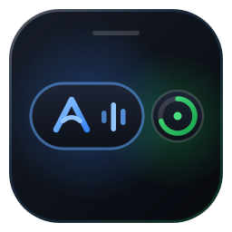
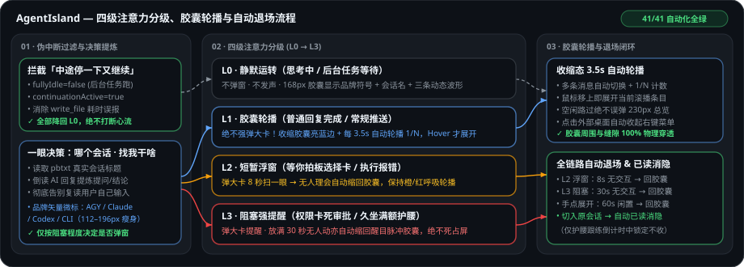
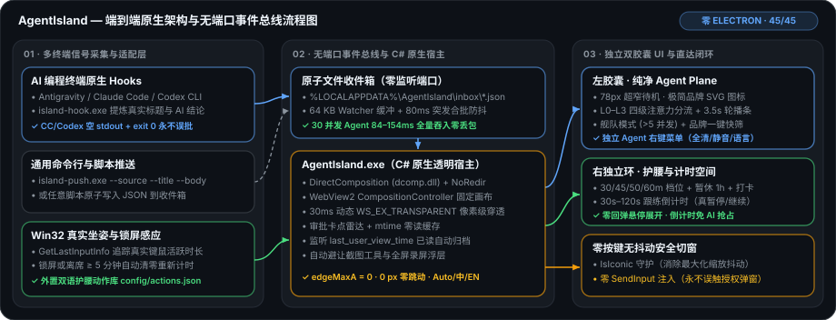

<div align="center">

<p>
  
</p>

<h1>AgentIsland</h1>

<p><strong>面向 AI 编程时代的 Windows 11 原生灵动岛（80 KB 零 Electron · 注意力分级雷达 · 护腰跟练）</strong></p>

<p><a href="README.md">English</a> · <a href="README.zh-CN.md">简体中文</a></p>

<p>
  <a href="https://github.com/Cooper-X-Oak/AgentIsland"></a>
  <a href="https://github.com/Cooper-X-Oak/AgentIsland/releases"></a>
  <a href="#核心工程亮点"></a>
  <a href="#注意力分级与交互流程"></a>
  <a href="LICENSE"></a>
</p>

<p>
  
</p>

</div>

---

## 为什么做 AgentIsland？

在 Windows 上每天高强度开着多个 AI 编程 Agent（**Antigravity、Claude Code、Codex CLI、Cursor**）干活 12–16 小时，有两个最折磨人的痛点：

1. **Agent 悄悄卡住干等**：切去浏览器或另一个项目干活，15 分钟后切回来才发现 Agent 早就停在「权限审批」或「等你拍板」弹窗上白等了。
2. **老腰快坐废了**：一进心流连续 3 小时焊在椅子上，根本记不起站起来深蹲或拉伸。

**AgentIsland** 以职责严格解耦的苹果式 **Split Pill（双岛并行）** 形态常驻在 Windows 11 屏幕正顶部：
* **左侧主胶囊（纯净 Agent Plane）**：极简品牌矢量徽标（`78–232 px`）、四级注意力分级、真实会话名与决策级 AI 摘要、30+ 并发舰队聚合与品牌快筛、一键直达会话；右键专管 Agent 静音与 `自动 / 中 / EN` 语言切换，绝不混入护腰杂项。
* **右侧独立小圆环（专属计时 & 护腰空间）**：通过 Win32 `GetLastInputInfo` + 锁屏检测累计真实坐姿时长（离席 ≥ 5 分钟或锁屏自动清零）；悬浮、点击或右键圆环均可独立控制间隔（`30/45/50/60m`）、`30s–120s` 真暂停/继续跟练、暂停 1h 与今日打卡。

---

## 核心工程亮点

* **零 Electron、零锯齿、零系统外阴影、零透明墙**：
  * 纯 C# 原生宿主仅 **80 KB**（完整免编译便携 zip 仅 **288 KB**），基于 **`WS_EX_NOREDIRECTIONBITMAP` + DirectComposition (`dcomp.dll`) + 系统内置 WebView2 CompositionController**；
  * 真正亚像素抗锯齿圆角与柔和投影（整圈外框实测 `Alpha = 0`）；
  * **真跨进程鼠标穿透**：通过 `WS_EX_LAYERED | WS_EX_TRANSPARENT` + 30ms 命中切换，胶囊周围空白区与双岛 8px 缝隙 100% 物理穿透，绝不挡下层浏览器标签；
  * **固定隐形画布**：展开/收起全程 Win32 窗口 0 像素位移，彻底杜绝闪烁与横跳；
  * 自动避让 Snipping Tool / 截图录屏工具顶栏。
* **注意力分级与极简品牌微胶囊**：
  * **去臃肿化品牌矢量符号**（`112–196 px` 极简胶囊）：用 Antigravity / Claude / Codex / CLI 专属 14×14 矢量符号 + 动态 3 条波形替代冗长的文字状态前缀；
  * **一眼决策内容**：读取真实会话标题（`annotations/*.pbtxt`），直接提炼 AI 实际提问或结论，彻底告别复读用户自己输入；
  * **四级分级 + 自动退场**：过滤后台任务导致的伪停止（`fullyIdle: false`），普通回复（L1）绝不弹大卡、只在收缩胶囊内每 3.5 秒轮播 `1/N`；拍板/报错（L2）8 秒自动缩回，权限审批（L3）30 秒未处理也自动缩回醒目脉冲胶囊；切入原会话自动已读消隐；
  * **物理双岛解耦 + 系统语言自适应（`自动 / 中 / EN`）**：启动自动匹配 Windows 系统语言，右键菜单一键 0ms 切换中英文与双语动作库；悬浮 `320ms` 按左右区域分别展开 Agent Plane 或计时护腰卡，点击外部桌面瞬间收起；`Alt + \` 随时展收，`Alt + Shift + \` 一键直达最新待介入会话。
* **开放零端口通知总线**：任何终端、脚本、CI 只要调用 `bin\island-push.exe` 或向 `%LOCALAPPDATA%\AgentIsland\inbox\` 写入 JSON 即可秒级上岛。
* **自带 45 项全视自检套件**：一行 `.\verify.ps1 -Rebuild` 自动验 Hook 契约、决策摘要、伪停止过滤、30 并发暴力压测、UX 状态机回归、DirectComposition、真实垫底窗 `WindowFromPoint` 穿透、5 态外缘 `Alpha = 0`、0 闪身并生成 4× 抗锯齿显微镜拼图。

---

## 注意力分级与交互流程

不是每一条 AI 动态都配得上强占屏幕打断你的心流。AgentIsland 先拦截「中途停一下又继续」的伪通知，再按阻塞程度分流到 **L0–L3 四个级别**，让顶部始终克制清爽：



---

## 30 并发多 Agent 舰队模式（实测零丢包）

同时开 **10 个 Antigravity + 10 个 Claude Code + 10 个 Codex** 狂跑怎么办？超过 5 个并发时胶囊自动切入 **Fleet 品牌聚合仪**，展开 `Agent Plane` 后自动解锁**按品牌一键快筛 + 丝滑滚轮列表**：

<div align="center">
  
</div>

* **真实 30 并发暴力压测已通过**：`30/30` 并发事件 **`143 ms` 全量吞入零丢包**（`64 KB` Watcher 缓冲 + `80 ms` 突发合批防抖 + `2.5s` 声音节流 + `mtime` 零读缓存 + `80` 会话容量保护）。

---

## 30 秒上手

### 方式一：下载免编译便携包（推荐）
1. 在 [Releases](https://github.com/Cooper-X-Oak/AgentIsland/releases) 下载 `AgentIsland-v0.1.1-win-x64.zip` 解压。
2. 双击 `bin\AgentIsland.exe` 运行（运行 `.\install-autostart.ps1` 可一键添加开始菜单与开机自启）。

### 方式二：源码编译（零 SDK 安装）
仅需 Windows 11（或已装 Edge WebView2 Runtime 的 Windows 10）。使用系统自带 `.NET 4.x csc.exe` 编译，首次运行自动从官方 NuGet 拉取 WebView2 DLL：

```powershell
git clone https://github.com/Cooper-X-Oak/AgentIsland.git
cd AgentIsland
.\build.ps1
.\start.ps1
```

立刻测试双路弹窗：
```powershell
.\test-push.ps1 -Mode both
```

---

## 接入你的 AI 编程终端

| AI 终端 | 状态 | 一键接入 |
| :--- | :---: | :--- |
| **Google Antigravity**（Hooks + `transcript.jsonl` 审批卡点雷达 + 零按键无抖动安全切窗） | 已真机验证 | `.\adapters\antigravity\install.ps1` |
| **Claude Code**（`UserPromptSubmit` / `PermissionRequest` / `Notification` / `Stop` Hooks） | 契约已测 | `.\adapters\claude-code\install.ps1` |
| **Codex CLI**（`~/.codex/hooks.json` 原生钩子 + 旧版 `notify` + `island-push.exe`） | 契约已测 | `.\adapters\codex-cli\install.ps1` |
| **Cursor / Windsurf / Cline / OpenCode** | 规划中 | 欢迎 PR！见 [`CONTRIBUTING.md`](CONTRIBUTING.md) |

### 通用命令行推送示例
```powershell
.\bin\island-push.exe --source "Codex" --project "api-server" --title "构建完成" --body "42 个单元测试全部通过" --kind info
```

---

## 自定义护腰动作与前端样式

* **新增/修改护腰与微运动动作**：直接编辑 [`config/actions.json`](config/actions.json)（可自由添加颈椎操、护眼、俯卧撑及倒计时秒数）。
* **改前端样式与动效**：直接编辑 [`ui/index.html`](ui/index.html)。
* 右键系统托盘图标 → **热重载前端与动作库**，零编译立即生效。

---

## 架构原理与全栈自测



随时运行 45 项全栈自动化验证（Hook 契约 + 30 Agent 压测 + DirectComposition + 穿透与像素边缘检测）：
```powershell
.\verify.ps1 -Rebuild
```

---

## 开源许可

[MIT](LICENSE)
